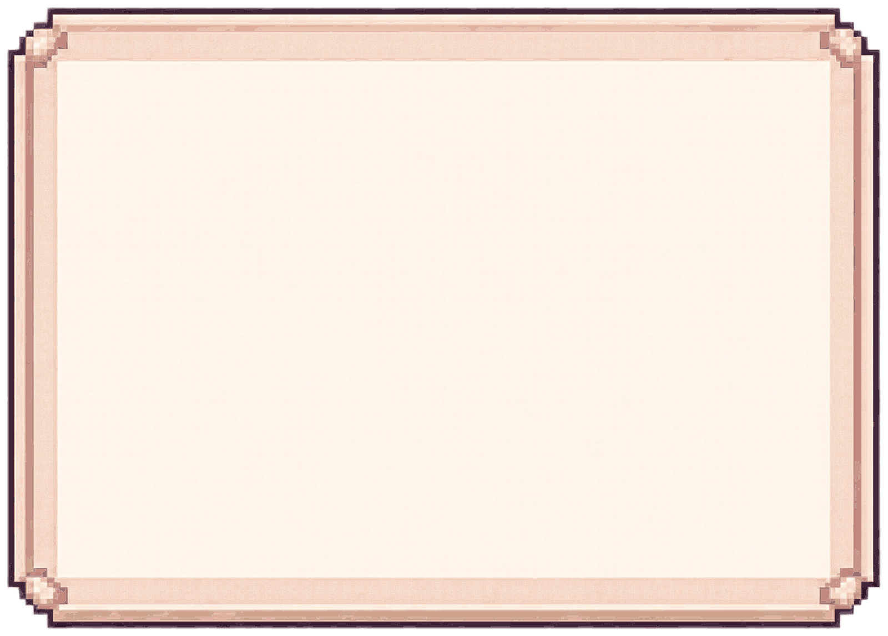

# 평산이의 하산 대작전 — 에셋 카탈로그

서비스에서 사용하는 픽셀 PNG 에셋을 역할별로 정리한 문서입니다. 모든 파일은 [`assets/SUNSET-asset`](assets/SUNSET-asset/) 아래에 있으며, 원본 파일명과 카테고리 구조를 유지합니다.

## 구성

| 카테고리 | 수량 | 위치 | 설명 |
|---|---:|---|---|
| Badge | 3개 | [`Badge`](assets/SUNSET-asset/Badge/) | 상태별 배지 |
| Brand | 2개 | [`Brand`](assets/SUNSET-asset/Brand/) | 로고와 브랜드 말풍선 |
| Character | 6개 | [`Character`](assets/SUNSET-asset/Character/) | 캐릭터 표정과 상태 |
| Icon | 14개 | [`Icon`](assets/SUNSET-asset/Icon/) | 시간, 날씨, 장비 등 기능 아이콘 |
| Scenery | 13개 | [`Scenery`](assets/SUNSET-asset/Scenery/) | 하늘, 산, 식생 등 장면 구성 요소 |
| Signal | 3개 | [`Signal`](assets/SUNSET-asset/Signal/) | 신호등 상태 이미지 |
| UI | 5개 | [`UI`](assets/SUNSET-asset/UI/) | 버튼, 패널, 말풍선 |
| **합계** | **46개** |  | 모두 PNG |

## Badge

- [`green.png`](assets/SUNSET-asset/Badge/green.png)
- [`yellow.png`](assets/SUNSET-asset/Badge/yellow.png)
- [`red.png`](assets/SUNSET-asset/Badge/red.png)

## Brand

- [`logo.png`](assets/SUNSET-asset/Brand/logo.png)
- [`speech_bubble.png`](assets/SUNSET-asset/Brand/speech_bubble.png)

## Character

- [`default.png`](assets/SUNSET-asset/Character/default.png)
- [`excited.png`](assets/SUNSET-asset/Character/excited.png)
- [`happy.png`](assets/SUNSET-asset/Character/happy.png)
- [`rest.png`](assets/SUNSET-asset/Character/rest.png)
- [`sad.png`](assets/SUNSET-asset/Character/sad.png)
- [`think.png`](assets/SUNSET-asset/Character/think.png)

## Icon

- [`battery.png`](assets/SUNSET-asset/Icon/battery.png)
- [`boot_green.png`](assets/SUNSET-asset/Icon/boot_green.png)
- [`boot_yellow.png`](assets/SUNSET-asset/Icon/boot_yellow.png)
- [`boot_red.png`](assets/SUNSET-asset/Icon/boot_red.png)
- [`calendar.png`](assets/SUNSET-asset/Icon/calendar.png)
- [`clock.png`](assets/SUNSET-asset/Icon/clock.png)
- [`exclaim.png`](assets/SUNSET-asset/Icon/exclaim.png)
- [`hourglass.png`](assets/SUNSET-asset/Icon/hourglass.png)
- [`lantern.png`](assets/SUNSET-asset/Icon/lantern.png)
- [`mountain.png`](assets/SUNSET-asset/Icon/mountain.png)
- [`phone.png`](assets/SUNSET-asset/Icon/phone.png)
- [`sparkle.png`](assets/SUNSET-asset/Icon/sparkle.png)
- [`sunset.png`](assets/SUNSET-asset/Icon/sunset.png)
- [`water.png`](assets/SUNSET-asset/Icon/water.png)

## Scenery

- [`bush.png`](assets/SUNSET-asset/Scenery/bush.png)
- [`cloud.png`](assets/SUNSET-asset/Scenery/cloud.png)
- [`grass.png`](assets/SUNSET-asset/Scenery/grass.png)
- [`grass_small.png`](assets/SUNSET-asset/Scenery/grass_small.png)
- [`mountain_range.png`](assets/SUNSET-asset/Scenery/mountain_range.png)
- [`pine.png`](assets/SUNSET-asset/Scenery/pine.png)
- [`rocks.png`](assets/SUNSET-asset/Scenery/rocks.png)
- [`sign.png`](assets/SUNSET-asset/Scenery/sign.png)
- [`sky_day.png`](assets/SUNSET-asset/Scenery/sky_day.png)
- [`sky_night.png`](assets/SUNSET-asset/Scenery/sky_night.png)
- [`sky_sunset.png`](assets/SUNSET-asset/Scenery/sky_sunset.png)
- [`stairs.png`](assets/SUNSET-asset/Scenery/stairs.png)
- [`sunset_mountain.png`](assets/SUNSET-asset/Scenery/sunset_mountain.png)

## Signal

- [`green.png`](assets/SUNSET-asset/Signal/green.png)
- [`yellow.png`](assets/SUNSET-asset/Signal/yellow.png)
- [`red.png`](assets/SUNSET-asset/Signal/red.png)

## UI 컴포넌트

### 라벤더 버튼

- 파일: [`button_lavender.png`](assets/SUNSET-asset/UI/button_lavender.png)
- 크기: 1658 × 362 px
- 용도: 보조 액션, 이전 단계, 다시 선택하기

### 노란색 버튼

- 파일: [`button_yellow.png`](assets/SUNSET-asset/UI/button_yellow.png)
- 크기: 1658 × 272 px
- 용도: 주요 액션, 확인, 다음 단계

### 라벤더 패널

- 파일: [`panel_lavender.png`](assets/SUNSET-asset/UI/panel_lavender.png)
- 크기: 1600 × 1859 px
- 용도: 설정, 선택지, 체크리스트 등 세로형 콘텐츠

### 크림 패널

- 파일: [`panel_cream.png`](assets/SUNSET-asset/UI/panel_cream.png)
- 크기: 1600 × 1147 px
- 용도: 결과, 안내, 미션 등 가로형 콘텐츠

### 말풍선

- 파일: [`speech_bubble.png`](assets/SUNSET-asset/UI/speech_bubble.png)
- 크기: 1600 × 1034 px
- 용도: 캐릭터 대사, 도움말, 상태 안내

## 사용 가이드

- PNG의 투명 배경을 유지하며 JPG로 변환하지 않습니다.
- 픽셀 테두리가 흐려지지 않도록 원본 비율과 정수 배율을 우선합니다.
- UI 이미지에는 텍스트가 포함되어 있지 않으므로 실제 문구는 별도 텍스트 레이어로 올립니다.
- 웹에서 사용할 때는 의미 있는 대체 텍스트를 지정합니다.
- 앱 번들에서 직접 사용할 파일은 필요에 따라 `src/assets`로 옮겨 import하고, 이 카탈로그의 원본은 변경하지 않습니다.
